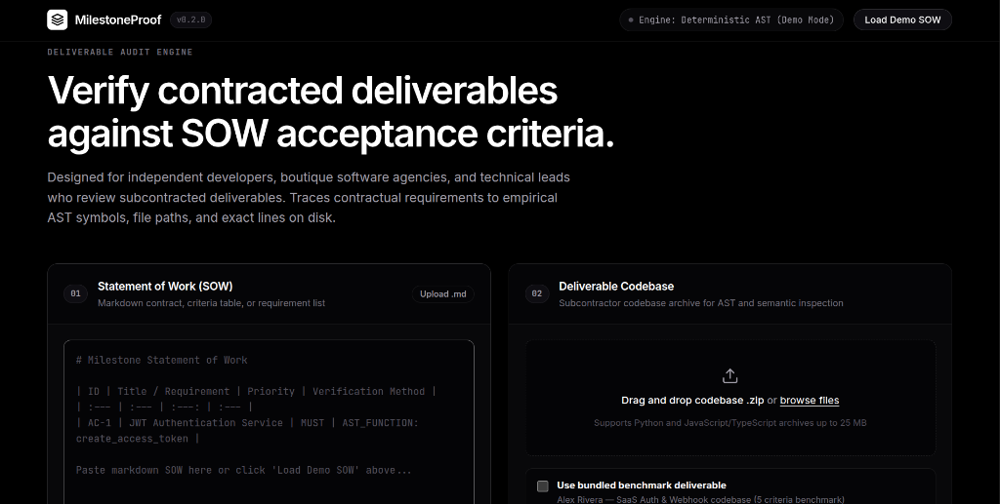
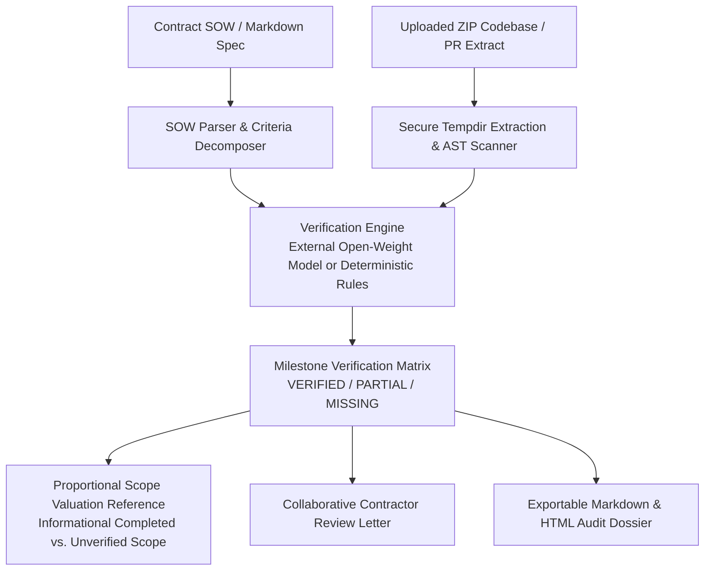

# 🛡️ MilestoneProof

> **SOW & Subcontractor Deliverable Verification Engine with Open-Weight AI**

[](https://milestoneproof.onrender.com/)
[](https://www.python.org/downloads/)
[](https://opensource.org/licenses/MIT)
[](https://dev.to/challenges/hacktoberfest-week2-2026-10-12)
[](https://huggingface.co)

---

### 🌐 [**Launch Live Demo: https://milestoneproof.onrender.com/**](https://milestoneproof.onrender.com/)

> **Instant Walkthrough**: Click **"Load Sample SOW"** in the web dashboard and upload a deliverable ZIP (or run the bundled sample) to generate an immediate line-accurate audit dossier—no account, setup, or API keys required.

---

## Overview



*The MilestoneProof deliverable audit workspace: Enter or upload a Statement of Work on the left, select or drag-and-drop a deliverable codebase archive on the right, and generate line-accurate evidence citations.*

**MilestoneProof** is an automated milestone audit engine designed for technical founders, agency owners, and engineering leads who outsource software deliverables to freelancers or subcontractors. It bridges the gap between written contract specifications (Statements of Work) and delivered codebases by extracting concrete, line-accurate code evidence, calculating proportional scope completion, and generating constructive contractor review letters.

---

## How to Try the Bundled Demo

You can test MilestoneProof immediately on the [Live Web Application](https://milestoneproof.onrender.com/):

1. **Open the live application**: Navigate to [https://milestoneproof.onrender.com/](https://milestoneproof.onrender.com/).
2. **Load the Sample SOW**: Click the **"Load Sample SOW"** button in the SOW panel to pre-populate a realistic subcontracting specification (e.g. Stripe Webhook & Authentication Deliverable).
3. **Upload the Sample Deliverable**: Select or drag-and-drop a deliverable codebase archive (or upload any deliverable ZIP), then click **"Run Milestone Audit"**.
4. **Inspect the Audit Dossier**:
   - **Verification Matrix**: View status breakdown (`VERIFIED`, `PARTIAL`, `MISSING`) mapped directly to exact source files and line numbers.
   - **Proportional Scope Valuation**: Informational completed vs. unverified scope valuation.
   - **Contractor Review Letter**: A pre-composed, polite, file-referenced message ready to copy and send back to the contractor for revision.
   - **Exportable Dossier**: Download the audit findings as structured Markdown or HTML for record-keeping.

---

## The Problem: The Milestone Verification Bottleneck

In technical freelancing and agency operations, consultants, solo founders, and technical leads outsource discrete modules to subcontractors on platforms like Upwork, Contra, or direct contract agreements: an authentication flow, a payment webhook handler, or a data ingestion pipeline.

When a contractor marks a milestone ready for review, you face an immediate verification bottleneck:
1. **Inspection Overhead**: Manually checking dozens of source files against the Statement of Work (SOW), inspecting route definitions, checking test suites, and confirming that acceptance criteria are actually met consumes substantial unbilled attention.
2. **Incomplete Delivery Risk**: Subcontractors sometimes miss specific requirements—such as omitting cryptographic signature verification on webhooks, leaving rate-limiting middleware unimplemented, or writing minimal happy-path tests. If an incomplete deliverable is accepted without inspection, the hiring developer inherits technical debt and unbilled rework.
3. **Subjective Communication Friction**: Addressing unverified deliverables without concrete, file-by-file citations can feel confrontational. Clear, line-level evidence helps keep communication professional, constructive, and productive.

---

## Key Features

- 📦 **Browser ZIP Codebase Upload**: Upload deliverable code as a `.zip` archive. The server safely validates against path traversal (Zip Slip), unpacks in an isolated temporary directory, and automatically cleans up after the audit.
- 🔍 **Line-Accurate Evidence Citations**: Every requirement is traced to exact source files, function signatures, route decorators, and line numbers on disk.
- 🤖 **Configurable Open-Weight Model Engine**: Connects via environment variables to any OpenAI-compatible open-weight inference provider (Groq, Hugging Face Serverless, OpenRouter) or local/remote Ollama.
- ⚙️ **Transparent Attribution**: Every finding is explicitly labeled with its evaluator (`AI_MODEL`, `DETERMINISTIC_ENGINE`, or `DETERMINISTIC_FALLBACK`). Deterministic results are never misattributed as AI findings.
- ⚖️ **Proportional Scope Valuation Reference**: Computes an informational scope completion score derived from weighted criteria.
- ✉️ **Collaborative Contractor Review Letter**: Automatically creates a professional, constructive review draft citing exact files and lines where revisions are needed.
- 📄 **Exportable Audit Dossiers**: Export comprehensive audit reports in both Markdown and HTML formats.

---

## Architecture & Workflow



---

## Technology Stack

- **Backend**: Python 3.10+, Flask, Gunicorn
- **Code Analysis**: Deterministic Abstract Syntax Tree (`ast`), Secure archive validation
- **Frontend**: Vanilla HTML5 & CSS (Sleek dark theme, micro-interactions, responsive flex/grid layouts)
- **AI Engine**: OpenAI-compatible client supporting open-weight models (Llama 3.2, Gemma 2, Qwen 2.5) via Groq, Hugging Face Serverless, OpenRouter, or Ollama, with robust deterministic fallback.
- **Deployment**: Render Web Service (Free Tier) with automated health checks (`/api/health`).

---

## AI Limitations & Reviewer Advisory

> [!IMPORTANT]
> **Legal & Reviewer Advisory Disclaimer**:
> MilestoneProof is an advisory and analytical tool. All findings, status matrices, and financial calculations are informative references for technical evaluation. All contractual compliance determinations, milestone acceptance decisions, and financial disbursements remain under the sole discretion and authority of the human reviewer.
>
> In the absence of external AI credentials or during network timeouts, MilestoneProof gracefully and transparently defaults to deterministic AST analysis. Every finding explicitly displays its source engine to prevent misattribution.

---

## Cloud Deployment (Render)

MilestoneProof is pre-configured for 1-click deployment on [Render](https://render.com) using [`render.yaml`](render.yaml):

1. **Push or Fork**: Ensure this repository is in your GitHub account.
2. **New Blueprint Instance**: In the Render Dashboard, select **Blueprints** -> **New Blueprint Instance**.
3. **Select Repository**: Connect `ayushg-1506/milestoneproof`. Render will detect `render.yaml` and configure the free web service with zero credential prompts.
4. **Deploy**: Click **Deploy Blueprint**. The application will build, verify `/api/health`, and launch in Deterministic Demo Mode.
5. *(Optional)* Add `MODEL_API_KEY`, `MODEL_API_BASE`, and `MODEL_NAME` under the service's **Environment** tab at any time to activate external open-weight AI inference.

---

## Local Development & Testing

For developers who want to run or contribute to MilestoneProof locally:

### 1. Quickstart
```bash
# Clone the repository
git clone https://github.com/ayushg-1506/milestoneproof.git
cd milestoneproof

# Install dependencies
pip install -r requirements.txt

# Run the local development server
python -m milestoneproof.app
```
Open **http://localhost:5000** in your browser.

### 2. Optional Environment Variables
To connect an external open-weight model locally, copy `.env.example` to `.env`:
```bash
cp .env.example .env
```
Example configuration for Groq (free tier):
```env
MODEL_API_BASE=https://api.groq.com/openai/v1
MODEL_API_KEY=your_groq_api_key_here
MODEL_NAME=llama-3.1-8b-instant
```

### 3. Run Automated Tests
```bash
python -m unittest discover tests
```
The test suite includes 28 unit and integration tests covering AST scanning, secure ZIP extraction, model parsing, and graceful fallback.

---

## License

[MIT License](LICENSE). Built for the Hacktoberfest 2026 Week 2 Open-Source AI Challenge.
